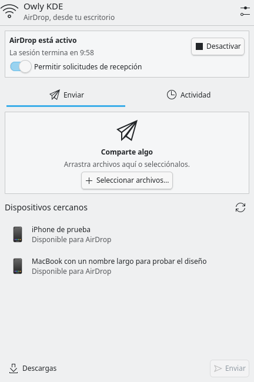
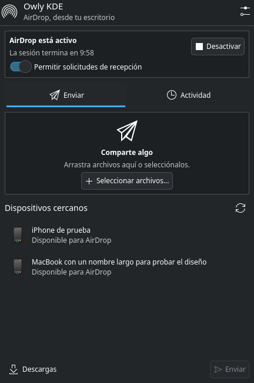

# Owly KDE

**AirDrop desde el panel de KDE Plasma.** Envía y recibe archivos con dispositivos
Apple mediante un elemento gráfico que se adapta al tema de tu escritorio.

Este fork de [Owly](https://github.com/t4t5/owly) está enfocado en KDE Plasma 6.
Conserva su motor de AirDrop y AWDL, y añade una interfaz nativa en QML con
Plasma Components, Plasma Extras y Kirigami.

**Primera versión preliminar:** [Owly KDE 0.1.1](https://github.com/Eirom16/owly-kde/releases/tag/kde-v0.1.1).
Incluye código fuente y un widget precompilado para Arch/CachyOS x86_64 con Qt 6.12.
Consulta los requisitos de cada descarga y el [historial de cambios](CHANGELOG.md).

<p>
  
  
</p>

*Interfaz real renderizada en Plasma con dispositivos simulados para las capturas.*

## Qué incluye

- Icono de panel y vista desplegable; también admite colocación en el escritorio.
- Colores, controles, tipografía, iconos y espaciado integrados con el tema de Plasma.
- Búsqueda de dispositivos Apple cercanos y selección del destinatario.
- Selección de varios archivos o arrastre al desplegable.
- Solicitudes de recepción con aceptación o rechazo explícitos.
- Progreso y cancelación de envíos, notificaciones e historial de transferencias.
- Carpeta de destino, nombre visible y duración de sesión configurables.
- Diagnóstico de la tarjeta y aviso cuando AirDrop necesita interrumpir el Wi-Fi.

La interfaz utiliza los comandos existentes de Owly con eventos `--json`.
El protocolo, las transferencias y la gestión de la radio siguen en los crates
originales de Rust. La compatibilidad depende de la tarjeta Wi-Fi; consulta
[el hardware soportado](#hardware-soportado).

## Instalación

Requiere **KDE Plasma 6**, **Qt 6.6 o posterior**, **Rust 1.88 o posterior**,
un compilador C++17 y CMake. Para compilar el widget hacen falta los archivos
de desarrollo de Qt Core, Gui, Qml, Quick y DBus. En ejecución necesita los
módulos QML de Plasma Components, Plasma Extras, Kirigami y Qt Quick Dialogs.

### 1. Obtener el fork

```sh
git clone https://github.com/Eirom16/owly-kde.git
cd owly-kde
```

### 2. Instalar el servicio de Owly

Si ya tienes un `owlyd` compatible instalado, puedes pasar al siguiente paso.
Para instalarlo desde este checkout:

```sh
cargo build --release --locked -p owlyd -p owly-cli
sudo packaging/install.sh owly
sudo systemctl daemon-reload
sudo systemctl enable --now owlyd
```

Si utilizas NetworkManager, recarga también su configuración después de la
primera instalación con `sudo nmcli general reload conf`.

### 3. Instalar el widget

```sh
bash plasma/install.sh
```

El instalador compila e instala el widget para tu usuario y deja la CLI con
soporte gráfico en `~/.local/bin/owly`. Después abre **Editar panel → Añadir
elementos gráficos**, busca **Owly KDE — AirDrop** y arrástralo al panel.
Para actualizar, vuelve a ejecutar el instalador. Si el widget estaba abierto,
cierra sesión y vuelve a entrar para cargar la biblioteca nativa actualizada.

También se genera `target/plasma/io.github.eirom16.owlykde.plasmoid`, instalable
desde **Añadir elementos gráficos → Instalar desde archivo local**. Incluye
una biblioteca nativa y debe compilarse en el sistema donde se utilizará.
Instalar únicamente ese archivo no instala la CLI ni el servicio.

Consulta [la documentación del widget](plasma/README.md) para compilarlo por
separado, configurar sus rutas o ejecutar las vistas previas.

## Compartir archivos

1. Abre Owly KDE desde el panel y pulsa **Activar**. La sesión predeterminada
   dura diez minutos; puedes cambiarla en la configuración.
2. En el dispositivo Apple, desbloquea la pantalla y habilita AirDrop para
   **Todos durante 10 minutos**.
3. Para enviar, selecciona o arrastra archivos, elige un dispositivo cercano
   y pulsa **Enviar**. Usa el botón de búsqueda para actualizar la lista.
4. Para recibir, mantén habilitadas las solicitudes y responde **Aceptar** o
   **Rechazar** cuando aparezca una. El receptor limita la respuesta a 15 segundos.

**Descargas** abre la carpeta de destino. **Actividad** muestra las últimas
transferencias y errores durante la vida de esa instancia del widget. Los
detalles de los errores se pueden seleccionar y copiar para diagnosticar un fallo.
Los enlaces recibidos se muestran como texto; no se abren automáticamente.

Cerrar el desplegable mantiene activa la sesión. Al desactivar, expirar el
plazo o retirar el widget, la CLI libera la radio mediante el servicio existente.
En tarjetas que usan modo exclusivo, el Wi-Fi se desconecta temporalmente.
La interfaz lo indica antes de activar la sesión.

## Hardware soportado

La compatibilidad y los informes de esta tabla proceden del motor de Owly.
El widget no cambia las capacidades de la tarjeta.

**Estado:** ✅ funciona en ambos sentidos; ⚠️ poco fiable; ❌ falla; ❓ sin probar.
**Shared** conserva el Wi-Fi; **Exclusive** y **Active monitor** lo interrumpen
mientras la radio está activa.

<!-- hardware-table:start -->
<!-- Generated by `cargo xtask hardware` from hardware/ and crates/owly-radio/drivers.toml: edit those, not this table. -->

| Card | Driver | Status | Tested on |
|---|---|---|---|
| MediaTek MT7925 | `mt7925e` | ✅ Shared | Framework 13, `14c3:0717`, Omarchy 4.0.4 (kernel 7.2.5) |
| MediaTek MT7612U (USB) | `mt76x2u` | ✅ Exclusive | `0e8d:7612` (kernel 7.2.9) |
| Realtek RTL8822BE | `rtw88_8822be` | ✅ Exclusive; shared untested | Crosshair VII Hero, `10ec:b822`, NixOS 26.11 (kernel 7.2.9) |
| Realtek RTL8852AE | `rtw89_8852ae` | ✅ Shared (opt-in) | ThinkPad P14s Gen 2a, `10ec:8852`, Ubuntu 26.04.1 (kernel 7.0) |
| Realtek RTL8852BE | `rtw89_8852be` | ✅ Shared (opt-in) | ASUS PRIME B550M-A WIFI II, `10ec:b852`, CachyOS (kernel 7.2.9) |
| Realtek RTL8852CE | `rtw89_8852ce` | ✅ Shared and exclusive (opt-in) | • Legion Slim 5 16AHP9, `10ec:c852`, Omarchy 4.0.4 (kernel 7.2.5)<br>• ThinkBook 16 G7 IML, `10ec:c852`, Ubuntu 24.04.5 (kernel 7.0) |
| Realtek RTL8852BU (USB) | `rtw89_8852bu` | ✅ Exclusive (opt-in), as a second card | USB adapter, `35bc:0108`, NixOS 26.05 (kernel 7.2.9) |
| Intel 9560 | `iwlwifi` | ✅ Exclusive | Lenovo 81SY, `8086:a370`, Omarchy 4.0.0 (kernel 7.2.8) |
| Intel AX200 | `iwlwifi` | ✅ Exclusive | ThinkPad X1 Yoga, `8086:2723`, NixOS 26.05 (kernel 6.19.8) |
| Intel AX201 | `iwlwifi` | ✅ Exclusive | • Ubuntu 24.04 (kernel 6.8)<br>• CachyOS (kernel 7.2.9)<br>• Intel Client Systems NUC10i7FNK, `8086:02f0`, NixOS 26.05 (kernel 6.18.55) |
| Intel AX211 | `iwlwifi` | ✅ Exclusive | • ThinkPad X1, `8086:51f1`, Ubuntu 26.04 (kernel 7.0)<br>• XPS 9320, `8086:51f0`, Arch (kernel 7.2.3)<br>• Legion Pro 7 16IRX8H, `8086:7a70`, Omarchy 4.0.4 (kernel 7.2.3)<br>• TUXEDO InfinityBook Max 15 Gen10 (Arrow Lake), `8086:7740`, Kubuntu 26.04.1 (kernel 7.0) |
| Intel BE (Panther Lake) | `iwlwifi` | ✅ Exclusive | XPS 16, `8086:e440`, Arch (kernel 7.2) |
| Intel BE200 | `iwlwifi` | ✅ Exclusive | GEEKOM IT13 Max, `8086:272b`, Omarchy 4.0.4 (kernel 7.2.5) |
| Intel 9260 | `iwlwifi` | ✅ Exclusive | `8086:2526`, Debian 13 (kernel 7.2.12) |
| MediaTek MT7921 | `mt7921e` | ⚠️ Exclusive, opt-in; shared fails ([#14](https://github.com/t4t5/owly/issues/14)) | `14c3:7961`, CachyOS (kernel 7.2.9) |
| MediaTek MT7922 (RZ616) | `mt7921e` | ⚠️ Exclusive, opt-in; shared fails ([#14](https://github.com/t4t5/owly/issues/14)) | Minisforum MS-A2, `14c3:0616`, NixOS 26.05 (kernels 6.18 and 7.2.5) |
| Realtek RTL8188FTV (USB) | `rtl8xxxu` | ⚠️ Exclusive (opt-in) | INTEL H81, `0bda:f179`, Linux Mint 22.3 (kernel 6.14.0): partly |
| MediaTek MT7927 | `mt7925e` | ❌ Shared: never heard; active monitor (opt-in) sends, but receiving times out ([#44](https://github.com/t4t5/owly/issues/44)) | TP-Link Archer TBE550E, `14c3:7927`, CachyOS (kernel 7.2.9) |
| Realtek RTL8821CE | `rtw88_8821ce` | ❌ Shared: OWL syncs but no transfer, Wi-Fi often lost after ([#60](https://github.com/t4t5/owly/issues/60)); exclusive receives nothing | HP laptop, `10ec:c821`, Omarchy (kernel 7.2.5) |
| Qualcomm WCN6855 (QCNFA765) | `ath11k_pci` | ❌ Can't create the monitor interface both modes need ([#45](https://github.com/t4t5/owly/issues/45)) | ThinkPad, `17cb:1103`, CachyOS (kernel 7.2.9) |
| Qualcomm WCN7850 (FastConnect 7800) | `ath12k_wifi7_pci` | ❌ Shared: receives nothing from the phone ([#40](https://github.com/t4t5/owly/issues/40)); exclusive untested | `17cb:1107`, Fedora 44 (kernel 7.2.9) |
| Intel Dual Band Wireless-AC 7265 | `iwlwifi` | ❌ Exclusive: firmware asserts on every ad-hoc start ([#16](https://github.com/t4t5/owly/issues/16)) | Zenbook UX305CA, `8086:095a`, Omarchy 4.0.4 (kernel 7.2.5) |
| Intel Wireless-AC 8260 | `iwlwifi` | ❌ Exclusive: firmware resets on channel 44; no transfer on 6 | NUC6i7KYK, `8086:24f3`, Home Assistant OS (kernel 6.12) |
| Intel Dual Band Wireless-AC 8265 | `iwlwifi` | ❌ Exclusive: firmware resets about 10 s after the ad-hoc cell starts; through a hidden AP, nothing heard from the phone | EliteBook x360 1030 G3, `8086:24fd`, Manjaro (kernel 6.12) |
| Intel AX210 | `iwlwifi` | ❓ Exclusive untested | — |

<!-- hardware-table:end -->

### Diagnóstico y problemas conocidos

```sh
owly doctor
owly test-card
```

`doctor` explica el modo disponible y qué impide activar la radio. `test-card`
guía una prueba con un iPhone y genera un informe para el
[registro de hardware](hardware/README.md).

- El modo compartido necesita que el punto de acceso esté en el canal **6, 44 o 149**.
- El cortafuegos debe permitir **TCP 8771 en `awdl0`** para recibir.
- El modo exclusivo en el canal 6 puede ser lento; algunas tarjetas Intel lo necesitan.
- La recepción funciona en modo **Todos**. **Solo contactos** requiere una identidad de Apple que el motor no implementa.

La configuración de la radio está en `/etc/owly/radio.toml`. Las reglas por
driver están en [`drivers.toml`](crates/owly-radio/drivers.toml), y se pueden
sobrescribir en `/etc/owly/drivers.toml`. Consulta el
[proyecto original](https://github.com/t4t5/owly#configuration) para las opciones
avanzadas y los detalles de sus modos de radio.

## Uso desde terminal

La CLI sigue disponible. Mantén la radio activa en una terminal y utiliza otra
para las transferencias:

```sh
owly radio up
# En otra terminal:
owly receive --dir ~/Downloads
owly browse
owly send --to "Jane's iPhone" photo.jpg
```

El widget administra su propia sesión: no es necesario ejecutar `radio up`
por separado al usar la interfaz gráfica.

## Desarrollo y pruebas

```sh
# Motor y adaptador de eventos de la CLI
cargo test --locked -p owly-cli
cargo clippy --locked -p owly-cli --all-targets -- -D warnings

# Adaptador Qt: sin tocar la radio ni la red
just plasma-check

# Comprobaciones originales del motor
just ci
```

Las pruebas del adaptador simulan la CLI para comprobar solicitudes, recepción,
envío, cancelación, argumentos de archivos y liberación de sesiones. La prueba
opcional de libplasma carga el paquete completo; los detalles están en
[`plasma/README.md`](plasma/README.md#arquitectura-y-comprobaciones).
El workflow **Plasma** compila el widget y ejecuta las pruebas Qt en GitHub Actions.
La validación de una transferencia real requiere un dispositivo Apple y una
tarjeta compatible.

El código gráfico está en [`plasma/`](plasma/). El motor se organiza en
`owly-airdrop` (AirDrop), `owly-awdl` (AWDL), `owly-radio` (hardware), `owlyd`
(servicio del sistema) y `owly-cli` (cliente). La documentación técnica del
protocolo continúa en [`docs/SPEC.md`](docs/SPEC.md).

## Créditos y licencia

Owly KDE es un fork independiente mantenido en
[Eirom16/owly-kde](https://github.com/Eirom16/owly-kde), basado en
[t4t5/owly](https://github.com/t4t5/owly). El motor de AirDrop, AWDL y radio,
así como los datos de compatibilidad, pertenecen a sus autores y colaboradores
originales. Este fork añade la experiencia gráfica para KDE Plasma.

Código bajo licencia [MIT](LICENSE). Los nombres de los servicios D-Bus y la
configuración del motor se conservan para mantener la compatibilidad con Owly.
